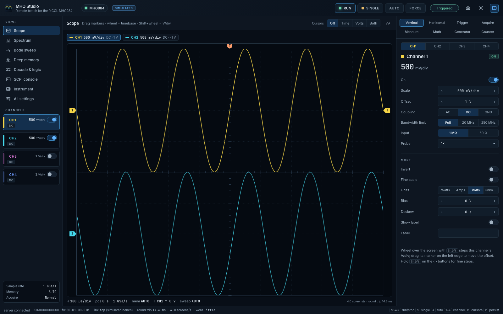
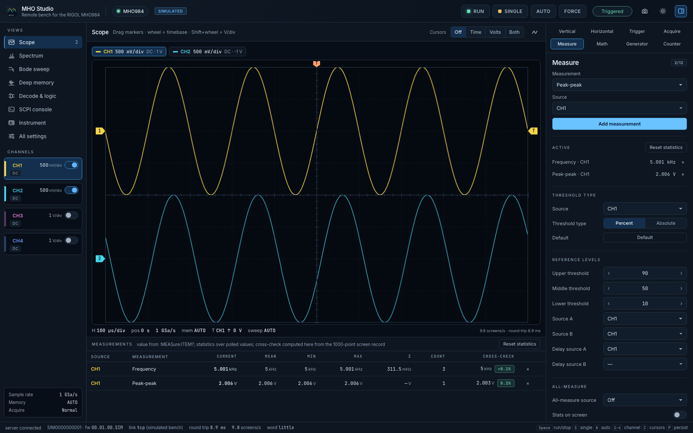
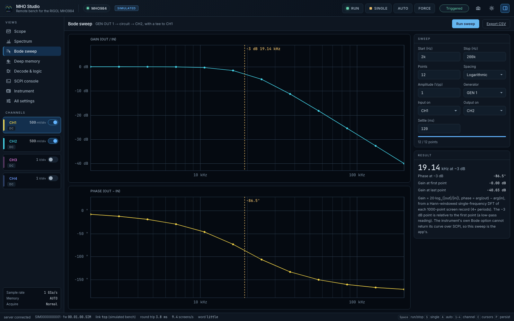
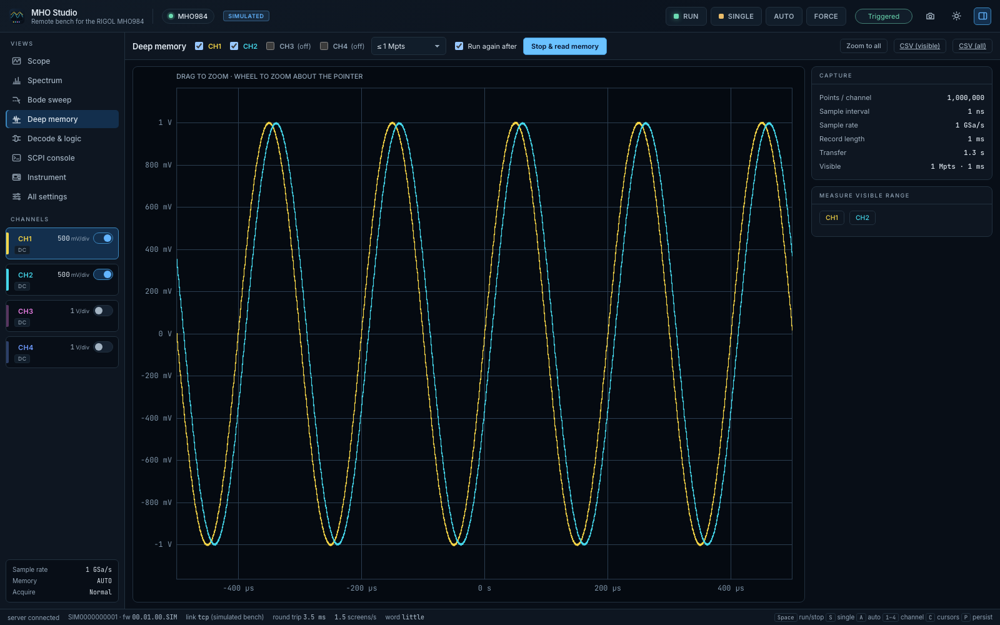
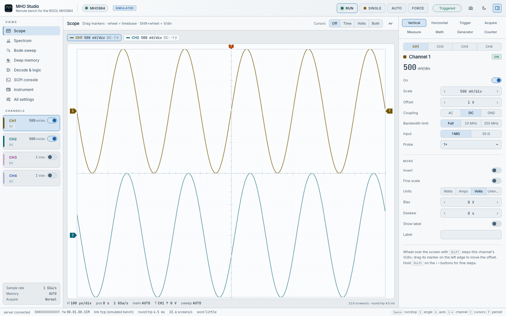

# MHO Studio

Remote bench for the **RIGOL MHO984** oscilloscope (800 MHz, 4 GSa/s, 12-bit,
4 analog + 16 digital channels, optional 2-channel generator): a live scope on
your computer, every setting of the instrument, and the analysis its own screen
cannot do — deep-memory capture, FFT with THD, a Bode sweep with the built-in
generator or with the Si5351 or the DAC on an STM32H743 board, bus tables,
presets, a SCPI console.

Also drives **Teledyne LeCroy X-Stream oscilloscopes** — the Windows-based
WaveRunner, WavePro, WaveMaster, SDA, DDA and LabMaster families — over VICP on
port 1861: live traces, the common settings, measurements, spectrum, deep
memory, screenshots, setups and a console that reaches every automation (VBS)
property. The app tells which family it is talking to from `*IDN?`.

And the **Teledyne T3DSO1000** series (T3DSO1204 in the lab; Siglent-made, the
same as Siglent's SDS1000X-E) over **USB** or raw SCPI on port **5025**: live
traces on its 14-division screen, the common settings, trigger, measurements,
deep memory, edge capture, screenshots, setups and a console.

All TypeScript (Node + React). Talks to the scope over **LAN** (raw SCPI on port
5555 for RIGOL, 5025 for a T3DSO, VICP on port 1861 for LeCroy) or **USB**
(USB-TMC on the rear USB Device port of the MHO984 or the T3DSO) — no VISA, no
NI drivers. Comes with a **simulated MHO984**, a **simulated LeCroy** and a
**simulated T3DSO1204**, so it works with no instrument connected.



| | |
|---|---|
|  |  |
|  |  |

## Install and run

```bash
./install.sh
```

Then double-click **MHO Studio** in App Launcher, or `~/Desktop/Apps/MHO Studio.app`
(or the `.command` next to it). It opens in your browser; a second double-click
brings back the running one. Needs Node 22.18 or newer.

**Updating.** The **⤓ Updates** button (top right; a gold dot when there is
something new) compares this copy with a branch of
[github.com/AmjadTrablsiD1/mho-studio](https://github.com/AmjadTrablsiD1/mho-studio)
— by default the branch it was installed from — and lists the commits it does
not have. **Update** downloads that commit, checks it is MHO Studio, runs the
installer on it (it needs internet for npm, a minute or two), and opens the new
version in a new window. Settings, presets and measurements are kept. It never
offers an older version: a copy installed from local changes that are not
pushed yet says so instead. Whatever you want on the other machines has to be
pushed to GitHub first. A copy started from its source folder is updated with
`git pull` + the installer; the single-file `.exe` is replaced, not updated.
At start-up the app looks (only reads) once a day; that can be switched off in
the dialog.

**Closing it ends the connection.** About 20 s after the last MHO Studio window
closes, the app disconnects the oscilloscope (and the STM32 board) and stops —
nothing stays connected in the background. A reload, or a laptop waking up,
brings the window back in time and nothing is lost; a Bode sweep or edge
capture still running is finished first. **⏻ Quit** (top right) does the same
at once. The tile starts it again and reconnects to the last instrument.

### Windows 10 / 11

1. Install **Node.js 22 LTS** (22.18 or newer) from <https://nodejs.org>, or in a
   terminal: `winget install OpenJS.NodeJS.LTS`.
2. Double-click **`install-windows.bat`** in this folder. It builds the app, copies
   it to `%LOCALAPPDATA%\Programs\mho-studio` and puts **MHO Studio** on the
   Desktop and in the Start menu (with its icon).
3. Start it from there. It opens in your browser; a minimised console window
   holds the server, and it stops by itself about 20 s after you close its tab.
4. If Windows Firewall asks about Node.js the first time you search the
   network, allow it on **Private networks**.

**Or no installation at all: `MHO Studio.exe`.** One file (about 60–70 MB)
that carries its own Node.js — copy it to the lab PC and double-click. Build
it with `cd ui && npm run build`, then `cd packaging && npm install && npm run
exe` (on Windows; output in `packaging\out`) — or on a Mac with
`npm run exe -- --target win-x64`, which uses the official Windows node.exe
(checked against nodejs.org's SHA-256 list) and leaves out the custom icon —
or download it from the **MHO-Studio-windows-exe** artifact of a GitHub
Actions run. It reaches scopes
over the network (LeCroy VICP, RIGOL LAN) and runs both simulators; RIGOL
**USB** is not inside the .exe (a native driver module cannot be). It is
unsigned: Windows SmartScreen may ask once (*More info → Run anyway*).

Settings and presets go to `%USERPROFILE%\.config\mho-studio`, the log to
`%USERPROFILE%\.local\state\mho-studio\server.log`. To run from the folder
without installing: `run-mho-studio.bat`.

**Not yet run on a Windows machine** — written and checked on a Mac. The code
paths that differ on Windows were reviewed (browser launch, ARP table, paths,
the test script), and `.github/workflows/ci.yml` runs every test, the
installer and the installed app on a real Windows runner as soon as this repo
is pushed to GitHub.

## Connecting the MHO984

1. LAN cable from the scope's rear panel to your network.
2. On the scope: **Utility → I/O → LAN**. Use DHCP or set an address; note the IP.
3. In MHO Studio type the IP (port 5555) and **Connect**, or **Find instruments
   on this network** to scan your subnet for anything that answers `*IDN?`.

No router? A cable straight from the scope to the computer works: either give both
ends addresses in one subnet (scope `192.168.10.2`, computer `192.168.10.1`, mask
`255.255.255.0`), or leave both on automatic — the scan finds a scope on a
self-assigned `169.254.x.x` address through mDNS (it announces itself as an LXI
instrument) and the ARP table.

### Or over USB

Connect the scope's **rear USB Device port** (square type-B socket; the front USB
port is for memory sticks) to the computer with a data cable, choose the **USB**
tab, and **Connect**. It speaks USB-TMC through the `usb` package (prebuilt, no
compiler, no VISA).

- **macOS:** nothing to install.
- **Windows:** the scope's USB interface needs the WinUSB driver. If NI-VISA or
  RIGOL UltraSigma installed its own driver, switch it once with
  [Zadig](https://zadig.akeo.ie/) (*Options → List all devices*, pick the RIGOL
  device, *WinUSB*, *Replace driver*). VISA software then no longer sees it over USB.
- **Linux:** the kernel's `usbtmc` driver is detached on connect; your user needs
  access, e.g. `/etc/udev/rules.d/99-rigol.rules`:
  `SUBSYSTEM=="usb", ATTR{idVendor}=="1ab1", MODE="0660", GROUP="plugdev"`.

It reconnects by itself if the link drops (LAN or USB, including unplug and
replug), and the same way to the same scope next launch.
On macOS, if the scope answers `ping` but not the app, allow Node under
*System Settings → Privacy & Security → Local Network* (the app also falls back
to `/usr/bin/nc`, which is exempt).

## Connecting a Teledyne LeCroy (X-Stream, Windows-based)

Checked for the **WaveRunner 640Zi** (4 GHz, 20 GS/s on 4 channels / 40 GS/s
on 2, 8-bit ADC with ERES to 11 bits, 16 Mpts/ch standard, 50 Ω and 1 MΩ
inputs, Windows 7 Embedded 64-bit): its datasheet lists "VXI-11 or VICP, LXI
Class C" and gigabit Ethernet, and every command the app sends was checked
against LeCroy's X-Stream Remote Control Manual (WM-RCM-E rev D) and
Automation Manual. Not yet run against the instrument itself. Deep memory
reads at most 25 Mpts per channel (the app's limit), so the M-option memories
(64/128 Mpts) are read in part.


1. LAN cable from the scope to your network, or straight to the computer.
2. On the scope: **Utilities → Utilities Setup → Remote**, set **Control from**
   to **TCPIP (VICP)**. The same page shows the scope's IP address (or look in
   the network settings of its Windows).
3. If the scope's Windows firewall is on, it must let TCP port 1861 in.
4. In MHO Studio choose **LAN → LeCroy · VICP** (port 1861), type the IP and
   **Connect**, or **Find instruments on this network**.

No router: give the scope's Windows and the computer addresses in one subnet
(e.g. `192.168.10.2` and `192.168.10.1`, mask `255.255.255.0`).

On a LeCroy the app offers:

- **Channels** — on/off, V/div, offset, coupling, probe, bandwidth limit,
  invert, averaging, deskew, interpolation, and a **name** per channel: it
  appears on the scope's own screen (LabelsText, switched on with ViewLabels) and
  everywhere in the app ("CH1 · VIN").
- **Triggers** — all eight types of the X-Stream automation manual: **Edge,
  Width, Glitch, Interval, Dropout, Logic (pattern), Qualify, State**, each with
  its own fields (limits or nominal ± delta, pattern per channel, qualifying
  source and wait…), source/level/slope/coupling, holdoff by time or events,
  Auto / Normal / Single / Stop, force, level to 0 V. Drag the T marker to move
  the trigger position.
- **Acquisition** — memory, sample rate, real time / RIS / sequence (segments),
  2- or 4-channel interleave, memory management, clear sweeps.
- **Screenshot** of the scope's display (camera button), **setups** (save,
  load, presets), **measurements** (22 LeCroy parameters with statistics and
  cross-check), **deep memory**, console.
- **Spectrum** — besides the live and deep-memory FFTs, **Scope FFT**: the
  scope transforms its whole record at the full sample rate (math trace F8,
  your F1–F7 untouched) and only the spectrum crosses the network, so a live
  spectrum of a fast signal does not alias. The app finds peaks and THD in it.
- **Fast on a slow link** — the values the app re-reads every few seconds
  travel in one VBS query instead of one each; deep memory of 8-bit data
  travels as bytes (half the size), as 16-bit words when averaging adds bits.

Not offered on a LeCroy: Bode sweep (no built-in generator), bus decode and
logic channels, math panel — those views are not shown. Settings the app has no
panel for are one line in the console, for example
`VBS 'app.Acquisition.Horizontal.SampleMode = "RIS"'` or
`VBS? 'return=app.Acquisition.C1.VerScale'`.

No scope yet: **Use the simulated MHO984** or **Use the simulated LeCroy**. It is a model of the instrument on a
bench — generator into CH1 and through a 20 kHz low-pass into CH2, a 1 MHz clock
on CH3, a UART on CH4 — speaking the same SCPI. See [sim/README.md](sim/README.md)
for exactly what it models and what it does not.

## Connecting a Teledyne T3DSO1000 (T3DSO1204)

The T3DSO1000 is made by Siglent (USB vendor 0xF4EC) and speaks Siglent's
SCPI, although it answers `*IDN?` with "Lecroy,T3DSO1204 ,…": the app picks the
driver by model. Checked on a T3DSO1204 (firmware 8.3.6.1.37R8) on 2026-10-14:
every reply format the driver reads was taken from that instrument.

- **USB** (simplest): a data cable into the rear **USB Device** port, then
  **USB → Connect**. Nothing to install on macOS; on Windows the interface
  needs the WinUSB driver (Zadig) if NI-VISA claimed it.
- **LAN**: **Utility → IO Set → LAN Config** on the scope shows its address.
  In MHO Studio choose **LAN → Teledyne T3DSO · SCPI** (port 5025). On a cable
  straight to the computer nothing hands out addresses: give the computer's
  network adapter a fixed address in the scope's subnet, with no router — e.g.
  scope `192.168.1.20` / `255.255.255.0`, computer `192.168.1.21` /
  `255.255.255.0` (System Settings → Network → the adapter → Details → TCP/IP →
  Manually).

What it offers: channels (on/off, V/div, offset, coupling incl. 50 Ω, probe,
20 MHz limit, invert, unit, deskew), timebase and trigger delay on the
14-division screen, memory depth (7K…14M; channels pair up as CH1/CH2 and
CH3/CH4), acquisition mode and averages, trigger type and source, level, slope,
coupling, Auto / Normal / Single / Stop, force, auto setup; 23 measurements
(PAVA) with statistics and cross-check; screenshots (its BMP kept as PNG);
setups (its XML file); deep memory; edge capture; console with the Siglent
command list. Not offered: Bode, decode, math panel, segmented capture.

What the instrument does differently, and the app copes with: numbers without
units after `CHDR OFF`; waveforms as "DAT2,#9…" + signed bytes + **two**
newlines; screenshots as a raw BMP without a length header; an empty USB
transfer after each block; `A?;B?` answers only `A`; the descriptor's time
origin is not filled in, so volts and times come from V/div, offset, time/div,
delay and sample rate.

## Bode with the STM32 board

Two outputs of the STM32H743 CORE V1.3 board can drive the Bode sweep instead
of GEN OUT. No reflash: the firmware's command link (protocol v16 or newer)
already sets both.

| | Si5351 (Board CLK0–2) | DAC (Board DAC PC4) |
|---|---|---|
| Where | the module on I²C2: P1 pins 12 SCL, 13 SDA, 3.3 V on pin 1 (`STM32H743/SI5351.md`) | **PC4** on P1: DAC1 channel 1 through OPAMP1, buffered (PA5 carries the same sine unbuffered) |
| Range | 2.5 kHz – 200 MHz | 1 Hz – 60 kHz |
| Waveform | 0–3.3 V square | sine on 1.65 V, amplitude set in the sweep (≤ 3 Vpp) |
| Frequency | 0.01 Hz steps, a fraction of a hertz from the request | timer rate ÷ table length — often a few hertz from the request |

Use the DAC for audio, control loops and anything below 2.5 kHz or that must
see a sine; the Si5351 for the higher decades. Both report the frequency they
actually produce, and the sweep plots that.

1. Plug the board's **COM** port (the CH340) into this computer. Close Board
   Test GUI and Loop Bench — the port can have only one owner.
2. **Bode sweep** → Generator **Board CLK0** (or 1, 2) or **Board DAC PC4** →
   **Connect to the board**. The card shows the firmware, the three Si5351
   outputs and what the DAC plays; **Detect** probes the Si5351 (choose the
   crystal and load capacitance it has).
3. Wire CLKx or PC4 to the circuit's input and, with a tee, to CH1; the
   circuit's output to CH2; common ground.
4. **Run sweep**. Each point is plotted at the frequency the board reports it
   produced. Afterwards a CLK output is put back as it was (frequency, on/off,
   drive); the DAC is stopped (if it was playing something before, the result
   says what — DacStatus does not report its levels, so it is not restarted).
   The port stays open until **Disconnect**.

The DAC cannot be used while a Loop Bench control-loop run or the board's own
sweep holds it (the board answers Busy, and the app says so). Each frequency
change restarts its table, a short glitch the settle time covers.

What the Si5351 means for the result:

- **2.5 kHz – 200 MHz.** Below that, use GEN OUT.
- **A 0–3.3 V square, not a sine.** Gain and phase come from the fundamental
  on both channels, so the harmonics and the DC level drop out — for a linear
  circuit. An amplifier near clipping, or a filter with a sharp peak at 3f,
  responds to the harmonics too; use a sine source for those.
- **Fixed amplitude.** For a small-signal circuit put a divider (e.g. 10:1)
  after CLKx and take CH1 after the divider. The channels are AC-coupled for
  this source.
- **The input channel is checked.** If CH1 does not show the generator's
  frequency at the first point, the sweep stops and says so (a channel wired to
  nothing still yields a plausible "gain").

The simulated board (Bode → Board → *Simulated board*, or `--sim-board`) puts
its DAC sine when one plays, else its lowest CLK output that is on, onto the
simulated bench in place of GEN OUT 1.

## What it does

- **Scope** — live traces of CH1–4 and math; drag the channel markers (offset),
  the trigger marker (level) and the T marker (position); wheel = s/div,
  Shift+wheel = V/div; time/voltage cursors; persistence; hover read-out.
- **Inspector** — vertical, horizontal (zoom, XY), trigger (all 20 types, each
  showing only its own fields), acquire, measure, math (incl. FFT and filters),
  generator (incl. AM/FM/PM), counter and voltmeter.
- **Every write is read back.** Ask for 300 mV/div and the field says
  "instrument set 200 mV/div"; instrument errors appear at the field.
  Switching a generator output on, 50 Ω input, factory reset, autoset and
  loading setups ask first.
- **Measurements** — all 41 of the instrument's, with running statistics and
  an independent cross-check the app computes from the waveform. **+ Measurement**
  adds one on the selected channel; every row's quantity and channel(s) can be
  changed afterwards in place (in the table under the screen or in the
  inspector), and × removes it.
- **Spectrum** — windowed FFT (Hann, Blackman-Harris, flat top, rectangular) in
  dBV RMS, averaging, peak list, THD with harmonics — from the live screen or
  from deep memory.
- **Bode sweep** — gain and phase of your circuit, with auto-ranging, −3 dB
  corner, CSV export. Your settings are restored afterwards. The generator is
  the scope's **GEN OUT** (AFG option), a **Si5351 output on the STM32H743
  board** (CORE V1.3, the module on I²C2), or the **board's DAC sine** on PC4,
  set over the board's serial link — see *Bode with the STM32 board* below.
- **Deep memory** — stops the scope and reads up to 25 Mpts per channel;
  zoom through it, measure a range, export CSV.
- **Edge capture** — for an event that happens **once** (an SPI transfer, a
  reset, a start-up sequence): arm one edge trigger in Single on the line that
  starts it, wait for it (as long as you say), record a window after it, read
  every point, and measure **every edge** of that one record on each chosen
  channel — 10–90 % rise and 90–10 % fall time, time from the trigger, spacing —
  with min / mean / max / σ, a plot of each edge's time over the burst, the
  list, and all edges as CSV. Also: high and low **pulse widths**, **glitches**
  (pulses narrower than a width you give) and **runts** (swings that turn back
  before the far level), a **histogram** of the rise and fall times with the
  slowest edges and how far each is from the rest, and the **setup and hold**
  of data lines against a clock (worst case, optional required values,
  violations; CSV of every clock edge). On a LeCroy, **segments**: one Single
  records N triggers (sequence mode), each with its time, analysed one by one.
  It warns when a channel is clipped off the screen (clipped edges look too
  fast) or sampled too slowly for its edges. The scope is left stopped on the
  event.
- **Decode & logic** — configure bus 1–4 for Parallel, UART, I²C, SPI, CAN, LIN
  (and FlexRay, I²S, 1553 with their options), read the event table; set up the
  16 digital channels.
- **All settings** — every one of the 596 settable values in the MHO900
  programming guide, searchable, each labelled with its SCPI header. On a
  LeCroy: the common X-Stream set (channels, timebase, memory, edge trigger,
  sample rate and mode, averaging, invert, bandwidth limit).
- **SCPI console** — completion from the guide's full command list, history,
  the error queue after every command, a view of all traffic.
- **Instrument** — identity, installed options, link diagnostics, presets
  (instrument setup files kept on disk), setup file download/upload, set the
  scope's clock from the PC, screenshot of its display.

Keys: <kbd>Space</kbd> run/stop, <kbd>S</kbd> single, <kbd>A</kbd> autoset,
<kbd>F</kbd> force, <kbd>1</kbd>–<kbd>4</kbd> channel, <kbd>C</kbd> cursors,
<kbd>P</kbd> persistence, <kbd>T</kbd>/<kbd>H</kbd>/<kbd>M</kbd> trigger/horizontal/measure.

## Tests

```bash
cd server && npm test        # core, service over TCP, over virtual USB-TMC, over VICP to the simulated LeCroy, over virtual USB-TMC and TCP to the simulated T3DSO1204, real T3DSO replies, edge capture on all three, discovery (139 tests)
cd server && npm run typecheck   # server, simulators and core (uses the TypeScript installed in ui/)
cd ui && npx playwright test # 19 UI flows × 2 themes (35 runs, 3 skipped by design), axe, fold probe at 1366×768 / 1440×900
```

## Limitations

- **LeCroy support has never met a real LeCroy.** It is written to the X-Stream
  remote control manual and the published VICP and WAVEDESC formats, and tested
  only against the simulated LeCroy (which was written from the same manual,
  so it cannot catch a misreading of it). Things the first real session must
  confirm are in TODO → Next. Queries a model does not answer are learned and
  skipped, as on the RIGOL.
- **LeCroy live screen is decimated without a filter**: the app asks for every
  Nth point (about 2000 per channel). On a fast acquisition, signals above the
  reduced rate alias on the screen trace and in a *live* spectrum — use Deep
  memory for spectra. An old scope's VICP link may be slow: a 10 Mpt channel is
  20 MB per read.
- **LeCroy over USB or GPIB is not supported**; LAN (VICP) only. Newer
  firmware also offers VXI-11 (LXI), which the app does not speak.
- **LeCroy trigger types** are the eight of the 2003 automation manual. Newer
  models add more (runt, slew rate, TV, serial…); the app shows such a type
  by name when the scope reports it, and it can be set from the console.
- **Not yet run against a real MHO984.** Everything has been built and tested
  against the simulator and the programming guide. The first session with the
  instrument should follow TODO → Next → 1.
- **Frame rate on hardware is unknown.** ~20 screens/s against the simulator;
  a real LAN round trip per query will lower it with four channels on.
- **WORD byte order** is not stated in the guide; the app measures it from the
  data and shows it (Instrument view). Until three clean screens have been seen
  it assumes little-endian.
- **RAW chunk size** (250 000 points per read) is an assumption; if the scope
  refuses it, lower `instrument.raw_chunk_points` in `shared/constants.json`.
- **Digital channels are not drawn** in the app's screen: the guide has no
  command that transfers their data. They are configured here and appear in the
  instrument screenshot.
- **The instrument's own Bode option** cannot return its curve over SCPI; the
  app's own sweep replaces it (with GEN OUT it needs the AFG50/AFG100 option,
  as the built-in one does; the STM32 board's Si5351 needs no option).
- **Bode with the STM32 board (Si5351 and DAC) has run on the simulators only** (0.5.0). The
  real board, its Si5351 and a known RC are the next step (TODO → Next).
- **USB has run on a real MHO984 on macOS** (1ab1:0452, fw 00.01.00); not yet on
  Windows or Linux drivers. About 4 screens/s with one channel over USB: the
  instrument takes 25–35 ms per query.
- **Some commands in the programming guide get no reply from firmware 00.01.00.**
  The app learns which (each costs one ~1.5 s timeout the first time), remembers
  them per firmware in `~/.config/mho-studio/unsupported.json`, shows them as
  "not answered by this firmware" and does not ask again.
- The window needs at least 1200 × 680 px.
- The Windows installer and launchers have not yet run on Windows (see "Windows 10 / 11" above).
- The first UI test ("scope: live traces…") has failed twice without a
  reproducible cause: once in four runs in September, and once (daylight theme,
  right after the LeCroy test) in three full runs on 2026-10-06; it did not
  recur in seven further full runs and four focused repeats. Its error text was
  lost both times; CI now keeps the trace of any failed UI test as an artifact.
- **Scope FFT levels** are the instrument's magnitude scaling; the manual does
  not say whether that is peak or RMS. Frequencies, peaks and THD do not depend
  on it; compare with a known sine before trusting absolute dBV.
- The server logs connections, lost links and unanswered queries to
  `~/.local/state/mho-studio/server.log` — look there first if something drops.

## Layout

See [ARCHITECTURE.md](ARCHITECTURE.md) for layers, data flows and how to extend
it, and [TODO.md](TODO.md) for what is done and what is next.

The command registry is generated from RIGOL's *MHO900 Programming Guide*
(`scripts/gen-manual-index.ts`); only facts — headers, types, ranges, defaults —
are kept, with the guide's section number on every entry. The LeCroy registry
(`core/src/registry/lecroy.ts`) is written by hand from the X-Stream remote
control manual's common command set.

## License

MIT
